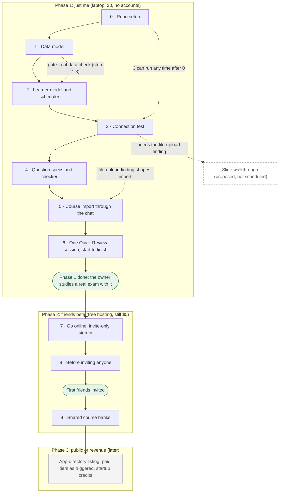

# Increment plan

**Status:** the direction was accepted on October 30, 2026 ([decision 0002](decisions/0002-run-inside-claude-and-chatgpt.md)). Each increment's contents are a proposal until the owner approves it. Each increment lands as one or more pull requests and ends with something the owner can check. This page is the roadmap; each increment's current status and review record live in [increments/](../increments/README.md).

**Roadmap version:** 2.0, November 1, 2026. What changed in each version is in [Roadmap history](#roadmap-history).

## Map

Every phase and increment in build order. Solid arrows are the order increments ship in, one at a time. Dotted arrows are extra dependencies the plan names. Dashed boxes are proposed, not scheduled. The map shows the plan's shape only; for where each increment stands now, see [increments/](../increments/README.md).

## Phases

| Phase                | Who uses it                    | Where it runs                                                | Cost                |
| -------------------- | ------------------------------ | ------------------------------------------------------------ | ------------------- |
| 1. Just me           | The owner                      | Laptop; Claude Desktop connects to a local StudyBuddy server | $0                  |
| 2. Friends beta      | The owner plus invited friends | Free-tier hosting, invite-only sign-in                       | $0                  |
| 3. Public or revenue | Anyone                         | Paid tiers as triggered; app-directory listing               | Paid when triggered |

## Phase 1: just me (local, $0, no accounts)

0. **Repo setup** ([record](../increments/000-repo-setup/README.md)). A TypeScript pnpm monorepo outside OneDrive, with formatting, linting, type-checking, tests, repo checks and CI; docs and decision records 0001–0002.
1. **Data model** in `packages/core`. Every record has an owner ID. Shared course content (course, topic, concept, question) is kept apart from personal records (session, answer event, confusion pair, concept state). Done when every record has a type and made-up fixture data.
2. **Learner model and scheduler** in `packages/learner`, replayed on the Exam 2 log through `tools/replay`. Done when it flags the same weak spots the real prep found: zone pricing, PLC stages and divisibility.
3. **Connection test.** A minimal local server with one tool and one screen, connected to Claude Desktop. It answers decision 0002's open questions:
   - Can uploaded slide files reach the server?
   - Do screens render from a local server?
   - Do Claude and ChatGPT behave differently? ChatGPT needs a public address, so this part may wait for Phase 2.

   This can run any time after increment 0, and should come before increment 5.

4. **Question specs and checker** in `packages/questions`. The server writes a spec: concept, angle, format, which answer is correct, and which sibling terms to use as wrong options. It then checks what the AI returns. Tried on one MGM 301 chapter.
5. **Course import through the chat** in `packages/ingest`. The learner uploads slides; the AI extracts concepts and calls a save tool; the server checks the result; the learner reviews it. The design depends on increment 3's file-upload finding.
6. **One Quick Review session start to finish** in Claude Desktop. Answers and confidence are submitted through a screen and logged automatically. Phase 1 is done when the owner studies a real exam with it.

### Data-quality gates in Phase 1

Each increment's record carries its own gate ([rules in CLAUDE.md](../CLAUDE.md#data-quality-gate-every-increment), approved November 1, 2026). This section sets the gates that have to be agreed **before** building. The owner approved the gate's principles, including zero wrong answer keys. The specific numbers below are **proposed** until the owner approves each increment's plan.

**Real data enters at increment 1, step 1.3.** Before increment 2 builds on the data model, a small real sample has to fit it:

- about 30 answers from the MGM 301 Exam 2 log, covering correct, incorrect, partly correct, unsure and regraded answers, including the zone pricing, PLC stages and divisibility misses
- about 10 slides from one real lecture deck

Both live in `data/private/`. As of November 1, 2026, **neither is on this laptop**, so step 1.3 is blocked and increment 2 is blocked behind it. The details are in [increment 001's record](../increments/001-data-model/README.md).

**Increment 2 (learner model) must also show:**

- Answers to draft or rejected questions, and unresolved grades, never change a concept's state. This is tested with a hand-worked example.
- The replay uses the real Exam 2 log, not the sample course.

**Increment 4 (question specs and checker), proposed acceptance criteria:**

- **Evaluation sample:** at least 30 questions generated from one real lecture chapter. Every concept in the chapter is covered, and every format appears: at least 8 scenario questions, plus calculation questions if the chapter has any.
- **Review method, in two passes:**
  1. **The code checker:**
     - exactly one correct option
     - every wrong option tagged with a sibling concept
     - rubric parts tied to the question's concepts
     - every cited slide or page exists
     - calculation answers recomputed by code
  2. **The owner** reviews each question against the cited slide on a review sheet, marking four things:
     - Is the answer key right?
     - Is there exactly one defensible answer?
     - Is the explanation accurate?
     - Is the question supported by the source?
- **Pass criteria:**
  - **zero wrong answer keys** in the reviewed sample
  - zero calculation answers that disagree with the code's own working
  - zero factual errors in explanations
  - zero questions without a supporting source
  - at most 2 of 30 ambiguous questions (rejected, not counted)
  - the code checker catches every defect in a set of 10 deliberately broken questions
- **After the evaluation:** every new question still starts as draft. In Phase 1 it becomes checked only after it passes the code checker and the owner's review. Whether a lighter process is safe later is an open question, decided from this sample's error rate.

**Increment 5 (course import), proposed acceptance criteria:**

- **Evaluation sample:** one full real lecture deck of at least 20 slides.
- **Review method:**
  1. Before seeing the AI's output, the owner lists the deck's concepts by hand (term and slide number) and marks the exam-critical ones. Doing this first keeps the AI's list from steering the owner's.
  2. Each extracted concept is then marked **matched**, **missing** or **unsupported** (not on the slides). Each definition is marked **faithful**, **loose** or **wrong** against its cited slide.
- **Pass criteria:**
  - at least 95% of the owner's concepts found, and every exam-critical one
  - zero unsupported concepts saved as checked
  - zero definitions that contradict the slide
  - every loose definition fixed by the owner before it's checked
  - the code refuses a cite to a slide that doesn't exist
- **After the evaluation:** extracted concepts start as draft. Only the learner's review makes them checked. Concepts don't have a check status yet (gap G1 in [increment 001's record](../increments/001-data-model/README.md)), so one has to be added before increment 5.

**Increment 6:** study recommendations and the session's results draw only on checked questions and checked concepts.

## Phase 2: friends beta (hosted, still $0)

7. **Go online.** The server goes on a free host, with Postgres and file storage on free tiers. Sign-in uses OAuth with an **invite list**, so only invited emails get in.
8. **Before inviting anyone:**
   - A short privacy note.
   - "Export my data" and "Delete my data".
   - Spending caps and alerts on every account.
   - A free scheduled backup to private storage (never Git).
   - A one-page "how to join" guide.
9. **Shared course banks.** Friends in the same class reuse that class's checked questions. Each person's answer log stays private.

Proposed: support Claude first, since its Free plan allows one custom connector. Third-party guides say ChatGPT custom connectors need a paid plan.

## Phase 3: public or revenue (later)

App-directory submission (review plus privacy policy), paid tiers as triggered, startup credits once StudyBuddy is a registered business.

## Proposed, not scheduled

### Slide walkthrough (requested October 30, 2026; not yet planned or approved)

The learner adds a lecture slide deck and walks through it slowly, one slide or idea at a time, learning as they go. This is a first capture of the idea only; it gets planned and approved step by step before it is scheduled.

Early notes:

- It fits the in-chat design well. The learner's AI explains each slide; a StudyBuddy screen shows where they are in the deck and asks short check questions; answers are logged automatically like everywhere else.
- It depends on the same open question as import: whether the slide file itself reaches the server (increment 3).
- It may overlap with Focused Review's guided teaching and with course import (a walkthrough could double as the review step for extracted concepts). How they relate is an open design question.
- Increment 1's data model should leave room for slides as a source: a source document with ordered slides, and concepts linked to the slide they came from.

## Where money is and isn't needed

**$0 through Phase 2**

| Item                                    | Why it's free                          |
| --------------------------------------- | -------------------------------------- |
| AI processing                           | Learners' own Claude or ChatGPT        |
| Development                             | Local                                  |
| Repo and CI                             | Private GitHub repo and GitHub Actions |
| Server, database, file storage, sign-in | Free tiers at friends scale            |
| Web address                             | Free subdomain                         |
| Backups                                 | A script                               |
| Privacy note                            | Written by us                          |

**Spending triggers**

| Trigger                                                                      | Likely cost                                                                       | How to delay it                     |
| ---------------------------------------------------------------------------- | --------------------------------------------------------------------------------- | ----------------------------------- |
| Free database pauses after 1 week of inactivity, or automatic backups wanted | Supabase Pro, $25/month                                                           | Regular use; backup script          |
| StudyBuddy charges money                                                     | Vercel Pro, $20/month (Hobby is non-commercial only), or another host's paid plan | Stay free during the beta           |
| StudyBuddy's own server calls AI                                             | Pay per use                                                                       | Build banks inside a learner's chat |
| Growth past free-tier limits                                                 | Varies                                                                            | Revenue or credits first            |
| Custom domain (optional)                                                     | About $10–15/year                                                                 | Use the free subdomain              |

**Learners' cost:** Claude Free works, with message limits. ChatGPT likely needs a paid plan (about $20/month); not confirmed by OpenAI.

## Open decisions

- Beta host and sign-in provider. Choose at increment 7; the sign-in provider must support MCP's OAuth sign-in. Re-check free-tier terms then.
- Reminder channel for day-later re-tests (email or calendar export).
- Whether the dashboard and calendar live as in-chat screens or a small separate website.
- When ChatGPT support is added.
- How the slide walkthrough relates to Focused Review and import.

## Sources (consulted October 30, 2026)

- [Supabase pricing](https://supabase.com/pricing): Free includes 500 MB database and 1 GB storage, pauses after 1 week of inactivity, no backups; Pro is $25/month.
- [Vercel fair use](https://vercel.com/docs/limits/fair-use-guidelines): Hobby is non-commercial only. [Vercel pricing](https://vercel.com/pricing): Pro is $20/month.
- [Railway pricing](https://railway.com/pricing) and [Railway plans](https://docs.railway.com/reference/pricing/plans): Free has $1/month credit; Hobby is $5/month. No longer needed under decision 0002.
- [Render free tier](https://render.com/docs/free): free Postgres expires after 30 days. Not suitable.
- [Cloudflare Workers pricing](https://developers.cloudflare.com/workers/platform/pricing/): free plan has 10 ms CPU per request; R2 has 10 GB free storage. A possible beta host now that parsing moves to the AI.
- [Supabase anonymous sign-ins](https://supabase.com/docs/guides/auth/auth-anonymous): merging into an existing account is manual. Supports dropping the anonymous preview for now.
- Platform sources are listed in [decision 0002](decisions/0002-run-inside-claude-and-chatgpt.md).

## Roadmap history

Every change to this page lands by pull request and gets a line here. A whole-number version means the plan itself changed: a phase or increment was added, removed, reordered or rescoped. A decimal version means the plan is the same and only its presentation or wording changed. Git keeps every earlier version of this page.

| Version | Date             | What changed                                                                                                        |
| ------- | ---------------- | ------------------------------------------------------------------------------------------------------------------- |
| 2.0     | November 1, 2026 | Data-quality gates: real data enters at step 1.3; gate rules for 2 and 6; proposed acceptance criteria for 4 and 5. |
| 1.1     | November 1, 2026 | Added the map and this history. No change to phases or increments.                                                  |
| 1.0     | October 30, 2026 | Direction accepted (decision 0002): three phases, increments 0 to 9, slide idea logged.                             |
